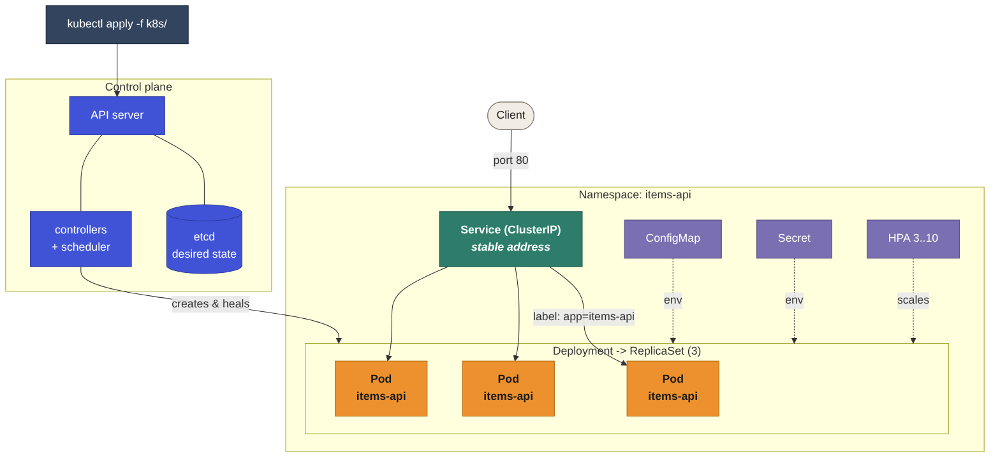

# Kubernetes Items API

The **same items API as my [serverless Terraform project](https://github.com/halemaa/terraform-serverless-api)** — but here it runs as a container orchestrated by **Kubernetes** instead of AWS Lambda. Building the *one app two ways* is deliberate: it shows the trade-off between **serverless** (no servers to manage, pay-per-use) and **orchestrated containers** (full control, always-on, self-healing).

This repo is built to be *read*. Every manifest is commented in plain language, and the [`theory/`](theory/) folder explains Kubernetes from zero.

> **One-line summary for a CV or interview:** *"I containerised a small API and ran it on Kubernetes with a Deployment of 3 self-healing replicas behind a Service, config and secrets injected from ConfigMap/Secret, liveness/readiness probes, resource limits, non-root hardening, an autoscaler, and a CI job that validates every manifest."*

---

## Architecture



`kubectl apply` sends the manifests to the **control plane**, which stores the desired state and continuously reconciles reality to match it. A **Deployment** keeps 3 Pod replicas alive (self-healing); a **Service** gives them one stable address and load-balances across them; **ConfigMap** and **Secret** feed configuration in as environment variables; the **HPA** scales the Pod count with load.

Diagram source: [`docs/architecture.mmd`](docs/architecture.mmd) (Mermaid).

---

## What's in here

```
.
├── app/app.py              the API (Python standard library only)
├── Dockerfile              packages the app as a non-root container image
├── k8s/
│   ├── namespace.yaml      isolates this app in its own namespace
│   ├── configmap.yaml      non-secret config (GREETING, MAX_ITEMS)
│   ├── secret.yaml         the API token (demo value — see SECURITY.md)
│   ├── deployment.yaml     3 replicas, probes, limits, hardening  <-- the core
│   ├── service.yaml        stable address in front of the Pods
│   └── hpa.yaml            autoscale 3..10 on CPU
├── docs/architecture.*     the diagram
├── theory/                 plain-language explanations, start at 00
└── .github/workflows/      CI: lint manifests (kubeconform) + build image
```

---

## Run it yourself

You need a Kubernetes cluster. The free, local way (no cloud, no cost) is
**[kind](https://kind.sigs.k8s.io/)** or **[minikube](https://minikube.sigs.k8s.io/)** plus
[Docker](https://www.docker.com/) and [kubectl](https://kubernetes.io/docs/tasks/tools/).

```bash
# 1. create a local cluster
kind create cluster

# 2. build the image and load it into the cluster
docker build -t items-api:1.0.0 .
kind load docker-image items-api:1.0.0
#   (then set image: items-api:1.0.0 in k8s/deployment.yaml for local runs)

# 3. apply everything
kubectl apply -f k8s/

# 4. watch it come alive (self-healing in action)
kubectl -n items-api get pods -w

# 5. call it (port-forward the Service to your laptop)
kubectl -n items-api port-forward svc/items-api 8080:80
curl localhost:8080/health
curl localhost:8080/items
curl -X POST localhost:8080/items \
     -H "X-API-Token: demo-token-not-a-real-secret" \
     -d '{"text":"my first item"}'
```

**See self-healing for real:** delete a Pod and watch Kubernetes replace it.
```bash
kubectl -n items-api delete pod -l app=items-api --field-selector 'status.phase=Running' | head -1
kubectl -n items-api get pods -w     # a new Pod appears within seconds
```

**Tear it all down:**
```bash
kubectl delete -f k8s/       # or: kind delete cluster
```

> You do **not** have to run a cluster to showcase this. The manifests, the
> Dockerfile, the diagram, and the CI `lint` job all stand on their own, and the
> CI validates every manifest with no cluster needed.

---

## Serverless vs. Kubernetes — when to use which

| | This repo (Kubernetes) | [Terraform serverless repo](https://github.com/halemaa/terraform-serverless-api) |
|---|---|---|
| Who runs the servers | You (a cluster is always on) | AWS (nothing to run) |
| Cost when idle | You pay for the cluster | ~$0 |
| Control / flexibility | Full (any language, any workload) | Constrained to the platform |
| Scaling | HPA adds Pods | Automatic, per-request |
| Best for | Always-on apps, complex systems, many services | Simple or spiky workloads, event-driven APIs |

Knowing *when to reach for which* is the senior-level judgment this pair demonstrates.

---

## Notes on scope (kept honest)

- **Data is in memory, per Pod.** Each replica has its own list, so items don't
  survive a restart and aren't shared across Pods. That keeps the focus on
  orchestration. A real deployment would use a **StatefulSet** database (e.g.
  PostgreSQL) or an external store — the serverless sibling used DynamoDB.
- The image reference is `ghcr.io/halemaa/items-api:1.0.0` as a placeholder;
  for a local cluster, build and load the image as shown above.

Security choices and known limitations are documented in [`SECURITY.md`](SECURITY.md).

*Built by [halemaa](https://github.com/halemaa) as a DevOps portfolio project.*
